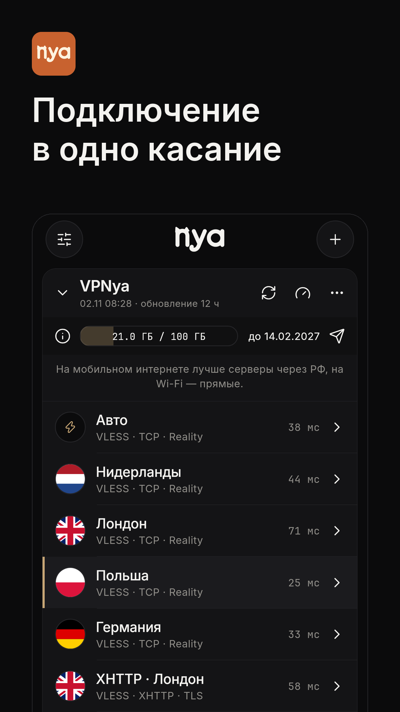
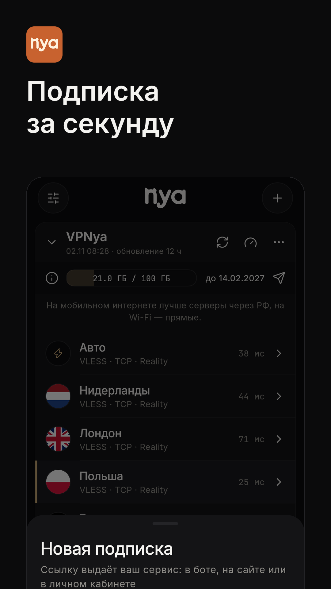
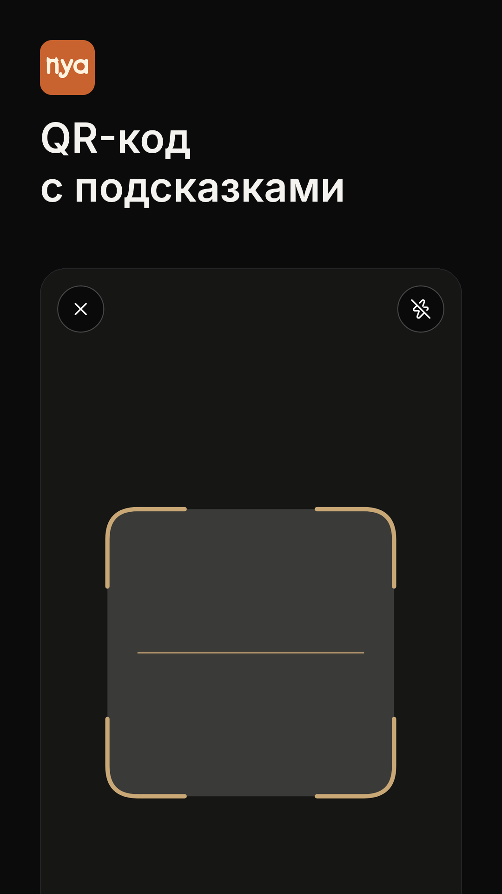

# nya

Приложение для подключения по вашей подписке. Пока его нет в App Store и Google Play, скачать можно здесь.

  
  
  

## Скачать

| Устройство | Файл |
|---|---|
| Android | [nya-arm64.apk](https://github.com/Pykucyka/nya-download/releases/latest/download/nya-arm64.apk) |
| Старые Android и Android TV | [nya-armv7.apk](https://github.com/Pykucyka/nya-download/releases/latest/download/nya-armv7.apk) |
| Новые Android TV | [nya-arm64.apk](https://github.com/Pykucyka/nya-download/releases/latest/download/nya-arm64.apk) |
| Компьютер, через эмулятор Android | [nya-x64.apk](https://github.com/Pykucyka/nya-download/releases/latest/download/nya-x64.apk) |
| Linux | [nya-linux-x64.tar.gz](https://github.com/Pykucyka/nya-download/releases/latest/download/nya-linux-x64.tar.gz) |
| Windows, macOS, iPhone, Apple TV | Скоро |
| Samsung и LG TV | Приложения на этих телевизорах не могут создать VPN. Подойдёт приставка на Android TV |

## Возможности

- Подключение одной кнопкой и автоматический переход на рабочий сервер, если текущий перестал отвечать.
- Подписка добавляется ссылкой, QR-кодом, вручную или кнопкой на странице подписки.
- Обновление подписки при запуске, в фоне и если потянуть список вниз.
- Точный пинг каждого сервера.
- Тонкие настройки: маршруты, DNS, выбор приложений, обход блокировок.

## Как добавить подписку

1. Установите приложение. Если телефон спросит, разрешите установку из этого источника.
2. Откройте страницу подписки у вашего сервиса и нажмите «Добавить в nya».
3. Или в nya нажмите плюс: вставьте ссылку из буфера, отсканируйте QR-код или введите её вручную.

## Как запустить APK на компьютере

APK сделан для Android, поэтому на компьютере ему нужен эмулятор Android. **VPN будет работать только внутри эмулятора, браузер и программы компьютера через него не пойдут.** Для всего компьютера дождитесь версии для Windows и macOS.

1. Установите [Android Studio](https://developer.android.com/studio). При установке оставьте компонент Android Virtual Device.
2. Откройте Device Manager, нажмите Create Device, выберите Pixel и образ x86_64 с Android 13.
3. Запустите устройство и перетащите файл [nya-x64.apk](https://github.com/Pykucyka/nya-download/releases/latest/download/nya-x64.apk) в его окно.
4. Откройте nya в эмуляторе и добавьте подписку.

На Windows должна быть включена виртуализация в настройках BIOS.

## Частые вопросы

**Подписка не добавляется.** Проверьте интернет и отключите другой VPN и «Частный DNS» в настройках телефона.

**Написано «Достигнут лимит устройств».** Удалите старое устройство в личном кабинете вашего сервиса.

**Сервер показывает «н/д».** Он сейчас не отвечает, выберите другой.

## Поддержка

Вопросы о подписке задавайте сервису, который её выдал.
