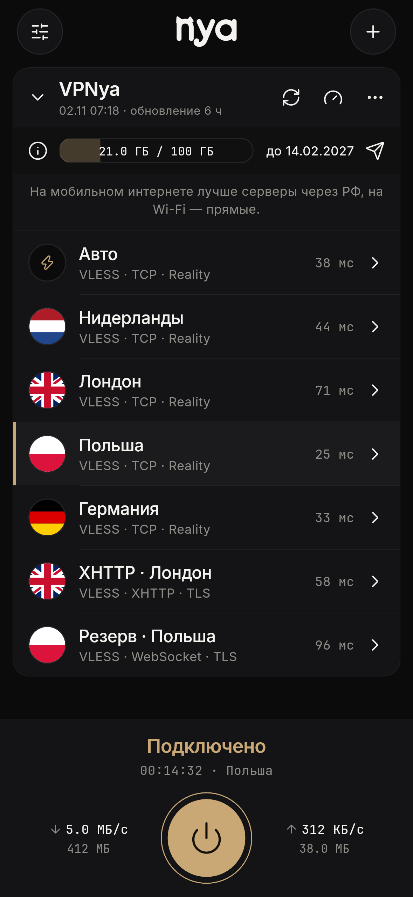
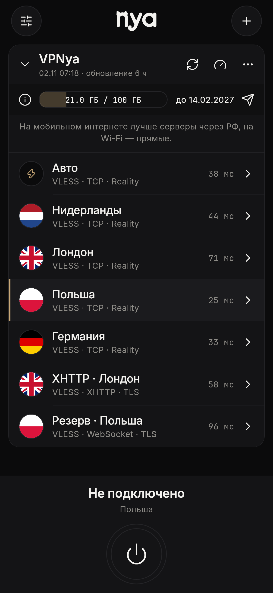
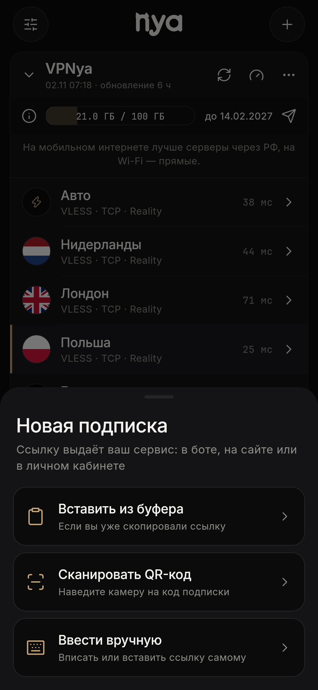

# nya

Приложение для подключения по вашей подписке. Пока приложения нет в App Store и Google Play, скачать его можно здесь.

  
  
  

## Скачать

| Устройство | Файл |
|---|---|
| Android и Android TV | [nya-1.3.0-arm64.apk](https://github.com/Pykucyka/nya-download/releases/latest/download/nya-1.3.0-arm64.apk) |
| Старые Android | [nya-1.3.0-armv7.apk](https://github.com/Pykucyka/nya-download/releases/latest/download/nya-1.3.0-armv7.apk) |
| Linux | [nya-1.3.0-linux-x64.tar.gz](https://github.com/Pykucyka/nya-download/releases/latest/download/nya-1.3.0-linux-x64.tar.gz) |
| Windows | Скоро |
| macOS | Скоро |
| iPhone | Скоро |

## Как установить на Android

1. Скачайте файл и откройте его.
2. Если телефон спросит, разрешите установку из этого источника.
3. Откройте nya, нажмите плюс и добавьте подписку: вставьте ссылку, отсканируйте QR-код или введите её вручную.

Если не знаете, какой файл нужен, берите первый из таблицы.
